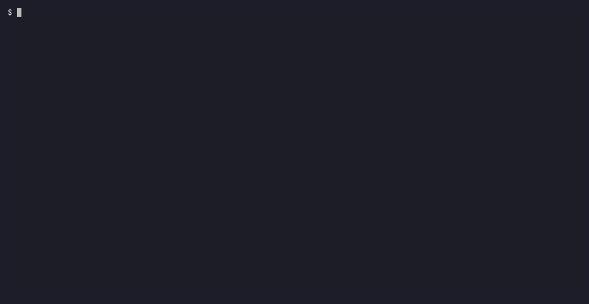

# terraform-drift-detection

[](https://github.com/ngems1/terraform-drift-detection/actions/workflows/ci.yml)


-success)
[](https://github.com/ngems1/code-clinic)

<p align="center"></p>

A **scheduled GitHub Actions pipeline** that runs `terraform plan` on every stack with a
read-only role, turns each plan (plus an optional Infracost estimate) into a short drift report,
and posts **one** message to **Slack** and/or **Microsoft Teams**: what changed outside
Terraform, attribute by attribute; what was merged but never applied; and which checks failed.
The whole pipeline is tested end to end on a laptop against an AWS emulator.

## What you'll learn

- What "drift" really is, and why `plan -detailed-exitcode = 2` mixes two different problems
  (someone changed prod, or nobody applied a PR).
- How to read `resource_drift` and `resource_changes` in plan JSON, and why raw
  `resource_drift` is too noisy to alert on.
- How to design an alert people keep reading: one message, only when needed, a weekly
  heartbeat, and failures that are never silent.
- Running a scheduled job against production safely: OIDC, a read-only role, `-lock=false`,
  and keeping the plan (with its secrets) on the runner.
- Testing infrastructure tooling end to end without a cloud account (Moto).

## Problem

> Create a CircleCI or GitHub Actions pipeline that runs infrastructure drift detection
> (Terraform plan + Infracost) on a schedule and posts results to Slack/Teams.
> (Code Clinic challenge #10)

**Assumptions**

- GitHub Actions (the course's CI) and AWS; the stack is a small example (`stacks/app-storage`:
  S3 bucket + SQS queue + DLQ). Add your stacks to `drift-targets.json`.
- "Post results" means a message only when there is something to act on, plus a Monday
  heartbeat ([ADR 0002](docs/adr/0002-one-message-per-run-and-a-weekly-heartbeat.md)).
- Infracost is optional: without `INFRACOST_API_KEY`, reports have no cost line.

## Architecture

```text
 schedule (weekdays 06:17) ─► targets job: drift-targets.json ─► matrix
                                                                   │
        ┌──────────────────────────────────────────────────────────┤ one job per stack/environment
        ▼                                                          ▼
 plan app-storage/prod                                     plan app-storage/staging ...
   OIDC → read-only role
   scripts/detect-drift.sh: init → plan -lock=false -detailed-exitcode → show -json
                            → (infracost) → driftwatch report → out/<stack>.json (artifact)
        └────────────────────────────┬─────────────────────────────┘
                                     ▼
 notify job (if: always()): missing reports → error reports → driftwatch notify → Slack / Teams
```

| Component | Path | Role |
|---|---|---|
| Scheduled workflow | [`.github/workflows/drift.yml`](.github/workflows/drift.yml) | targets → plan matrix (read-only OIDC role) → one notify job |
| Per-stack script | [`scripts/detect-drift.sh`](scripts/detect-drift.sh) | init, plan, optional Infracost, report; a failure becomes an `error` report |
| Report | [`src/driftwatch/plan.py`](src/driftwatch/plan.py) | drift (changed outside Terraform **and** reverted by apply), pending code, accepted differences, masked values |
| Messages | [`src/driftwatch/render.py`](src/driftwatch/render.py) | Slack Block Kit, Teams Adaptive Card, Markdown (job summary), text |
| Delivery | [`src/driftwatch/notify.py`](src/driftwatch/notify.py) | HTTPS only, retries with `Retry-After`, the URL is never logged |
| Example stack | [`stacks/app-storage/`](stacks/app-storage/) | runs on AWS or on Moto (`aws_endpoint`), with `terraform test` |
| Targets / backends | [`drift-targets.json`](drift-targets.json), [`backends/`](backends/) | which stacks and environments, where their state is |
| Accepted differences | [`drift.toml`](drift.toml) | known perpetual diffs, each with a reason |

## Prerequisites

- Python 3.11+ and [uv](https://docs.astral.sh/uv/); Terraform 1.10+; Docker for the e2e test.
  Or open the **dev container** (image 1.1.0): everything is installed.
- For real use: an AWS IAM role that trusts GitHub OIDC for this repository's `main` branch,
  with `ReadOnlyAccess` and read access to the state bucket; a Slack incoming webhook and/or a
  Teams Workflows webhook.

## Usage

**Try it locally (no AWS account):**

```bash
make setup
make e2e        # Moto in Docker: apply, change 3 things "in the console", detect, notify a fake Slack/Teams
make demo       # the three real e2e plans as reports + the Slack payload
```

<p align="center"></p>

**In your repository:**

1. List your stacks in `drift-targets.json` and their backends in `backends/<env>.hcl`.
2. Repository variable `DRIFT_ROLE_ARN`; secrets `SLACK_WEBHOOK_URL` and/or `TEAMS_WEBHOOK_URL`,
   optionally `INFRACOST_API_KEY`.
3. Run **Actions → drift → Run workflow** with *heartbeat* ticked to see a first message.

The same steps by hand, for one stack:

```bash
BACKEND_CONFIG=backends/prod.hcl TF_VAR_environment=prod \
  scripts/detect-drift.sh stacks/app-storage app-storage/prod out
uv run driftwatch notify out/*.json --slack-webhook-env SLACK_WEBHOOK_URL --dry-run
```

## Examples

| File | What it shows |
|---|---|
| [`tests/fixtures/plans/drift.json`](tests/fixtures/plans/drift.json) | a real plan after three out-of-band changes (from the e2e test) |
| [`tests/fixtures/plans/pending.json`](tests/fixtures/plans/pending.json) | a code change that was never applied |
| [`tests/fixtures/plans/clean.json`](tests/fixtures/plans/clean.json) | a clean stack whose `resource_drift` is still full of harmless noise |
| [`tests/e2e/drift.toml`](tests/e2e/drift.toml) | accepted differences with reasons (the emulator's perpetual diffs) |
| [`drift-targets.json`](drift-targets.json) | two targets: app-storage in staging and prod |

## Configuration

| Setting | Where | Meaning |
|---|---|---|
| `drift-targets.json` | repo | `[{stack, environment, region}]`: one plan job each |
| `backends/<environment>.hcl` | repo | S3 backend settings passed to `terraform init` |
| `vars.DRIFT_ROLE_ARN` | GitHub variable | read-only role assumed via OIDC |
| `secrets.SLACK_WEBHOOK_URL` / `TEAMS_WEBHOOK_URL` | GitHub secrets | where to post (either or both) |
| `secrets.INFRACOST_API_KEY` | GitHub secret | adds "apply would change the monthly cost by …" |
| `drift.toml` | repo | `[[ignore]] address, attributes, reason`: accepted differences |
| `notify --fail-on` | workflow | `error` (default) · `drift` · `pending` · `never`: when the job turns red |
| `notify --heartbeat` | workflow | post even when clean (Mondays and manual runs) |

| Exit code | `report` | `notify` |
|---|---|---|
| 0 | report written (a broken plan becomes an `error` report) | delivered, or nothing to say |
| 1 | — | a `--fail-on` condition was met |
| 3 | cannot write the report | delivery failed, bad input, no channel |

## 💰 Cost

| Item | Monthly cost |
|---|---|
| GitHub Actions: ~5 min × 22 weekdays per target (public repo: free; private: within the free minutes) | $0 |
| AWS API calls for a read-only plan (Describe/List/Get) | $0 |
| State reads from S3 (a few GETs per run) | < $0.01 |
| Infracost (free tier, optional) · Slack / Teams webhooks | $0 |
| **Total** | **≈ $0** |

The value is on the other side: a console-resized instance or a disabled versioning setting is
caught the next morning instead of at the next incident.

## 🧹 Cleanup / teardown

Locally: `make lab-down` (and `docker network rm drift-e2e`); `.e2e/` and `.lab/` hold local
state and can be deleted. In a repository: disable the `drift` workflow, delete the webhook
secrets (and revoke the webhooks in Slack/Teams), and delete the IAM role.

Not removed automatically: report artifacts are kept 14 days (`retention-days`); messages
already posted stay in the channels.

## 🏠 Run it locally for free

`make e2e` starts **Moto** (an open-source AWS emulator; LocalStack now requires an account,
see [ADR 0004](docs/adr/0004-local-e2e-on-moto.md)) and runs `tests/e2e/run.sh` in the course
image. It:

1. applies `stacks/app-storage` (state in Moto's S3) → report **clean**, nothing posted;
2. posts a **heartbeat** to a fake Slack and a fake Teams endpoint;
3. changes three things with the AWS CLI (versioning suspended, a tag added, visibility timeout
   60 → 300) → **drift**, and checks both payloads name the resources and attribute changes;
4. re-applies, then changes the code without applying → **pending**, not drift;
5. breaks the backend → **error** report, posted, notify exits 1.

`make lab-shell` gives you the same environment interactively for the [drills](docs/DRILLS.md).

## Security considerations

See [docs/THREAT-MODEL.md](docs/THREAT-MODEL.md). In short: a **read-only** role through
GitHub **OIDC** (no stored keys); the plan file, which contains secrets in clear text, never
leaves the runner, and only small JSON reports are uploaded; values are shortened and
sensitive attributes masked; webhook URLs live in secrets and are never printed; plain-http
webhooks are refused.

## Idempotency notes

Detection changes nothing: a read-only plan with `-lock=false` writes no state and takes no
lock, so running it twice, or during an apply, is harmless. The same plan and `drift.toml`
always give the same report. The only side effect is the message; it is repeated every
weekday while drift remains (by design, ADR 0002).

## Running this in production

**Signals to watch**

| Signal | Meaning | Action |
|---|---|---|
| no Monday heartbeat | the workflow didn't run (disabled after 60 days without commits, schedule broken, webhook revoked) | check Actions; re-enable; rotate the webhook |
| `error` stacks | detection is blind for that stack | fix credentials/state access today |
| `drift` repeating for days | nobody owns the decision | route the stack to its owning team |
| `pending` | merged code was never applied | find the apply pipeline run that failed |
| growing `drift.toml` | blind spots accumulating | review entries quarterly |

**Runbook**

1. *Drift on a prod resource.* Ask in the thread who changed it and why (CloudTrail has the
   API call). Then either `terraform apply` (the code wins) or a PR that encodes the change.
2. *An `error` stack.* Read the message: `AccessDenied` → role or trust policy changed;
   `NoSuchBucket` / `state` → backend config; `provider` errors → pin or upgrade. Run
   **drift → Run workflow** after the fix.
3. *A noisy attribute every day.* Confirm it's a perpetual diff (`terraform plan` shows it on
   an untouched stack), fix the cause if you can, else add a `drift.toml` entry with a reason.

**Rolling back:** the pipeline changes nothing, so there is nothing to roll back; revert a bad
`drift.toml` or workflow change like any commit.

## Testing

```bash
make all     # lint + test (pytest + bats) + tf + security + docs
make e2e     # the full pipeline against Moto (Docker)
```

- **64 pytest tests** (98% coverage) on the **real plans** produced by the e2e test plus
  synthetic edge cases (deleted resources, sensitive values, long values, ignores, retries,
  `Retry-After`, https only, exit codes).
- **6 bats tests**: every exit path of `detect-drift.sh` ends in a report; plan files deleted.
- **`terraform test`** (4 runs, mock provider), tflint (aws ruleset), Checkov.
- **e2e** on Moto as described above.

## CI checks

| Job | Runs |
|---|---|
| `repo` (hub) | gitleaks, actionlint, course self-check |
| `python-oldest` / `python-latest` (hub) | ruff, mypy, pytest on 3.11 and 3.14 |
| `shell` (hub) | ShellCheck, bats `tests/bats` |
| `terraform` (hub) | fmt, validate, tflint, `terraform test`, Checkov, Infracost PR comment (with a key) |
| `e2e` | `tests/e2e/run.sh` with Moto as a service container |

The scheduled `drift.yml` is the product itself; it needs your role and webhooks, so it runs
only in a real repository. CI also runs weekly to catch new Terraform, provider or Moto releases.

## Repository layout

```text
.github/workflows/   drift.yml (the product) · ci.yml
scripts/             detect-drift.sh · save-fixtures.py
src/driftwatch/      plan.py · config.py · cost.py · render.py · notify.py · cli.py
stacks/app-storage/  example stack (+ terraform test)
backends/ drift-targets.json drift.toml
tests/               pytest · bats/ · e2e/ (run.sh, lab.sh, webhook sink) · fixtures/plans/
docs/                LEARN.md · DRILLS.md · THREAT-MODEL.md · adr/ · images/
```

Learn the concepts in [docs/LEARN.md](docs/LEARN.md), break things with
[docs/DRILLS.md](docs/DRILLS.md), and read the trade-offs in [docs/adr/](docs/adr/).
Part of the [Code Clinic course](https://github.com/ngems1/code-clinic).

## License

[MIT](LICENSE) © ngems1
# terraform-drift-detection

